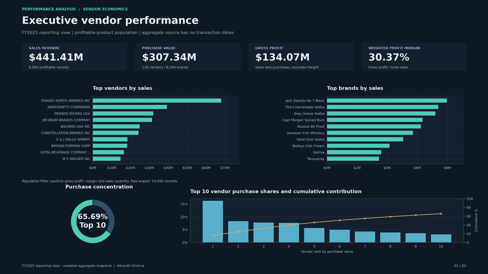
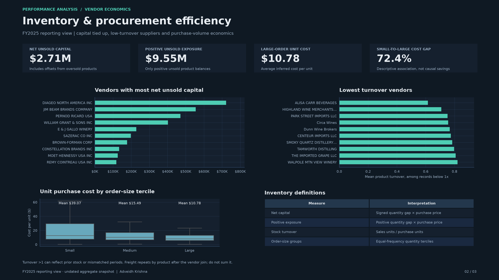
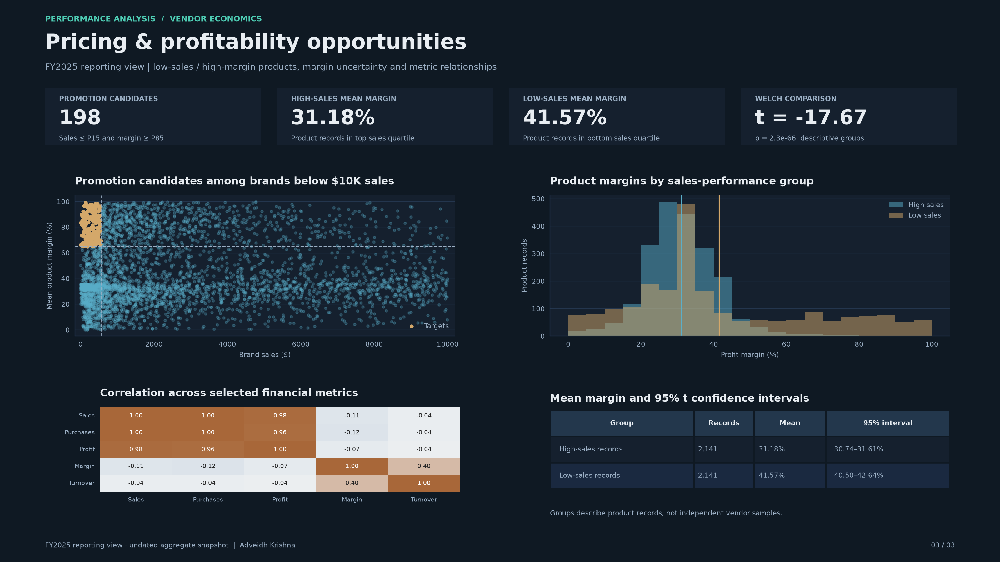

# Vendor Performance Analysis — FY2025 reporting view

## Scope

The included export contains 10,692 undated aggregate product/vendor records. The selected analysis population has 8,564 records with positive gross profit, margin and sales quantity. The year is a reporting label; the source cannot establish dated full-year coverage or monthly trends.

## Financial performance

| Metric | Recomputed result |
|---|---:|
| Sales revenue | $441,408,069.45 |
| Purchase value | $307,338,437.47 |
| Gross profit | $134,069,631.98 |
| Weighted gross margin | 30.37% |
| Vendors / brand codes | 118 / 8,544 |
| Top-ten vendor purchase contribution | 65.69% |

Gross profit excludes freight and other operating costs. Weighted margin replaces the sum of product percentages. Supplier concentration warrants a review of dependency and negotiation options; it does not by itself establish an optimal allocation.

## Inventory and procurement

Net unsold capital is **$2,708,177.22** after negative product balances offset positive ones. Positive unsold exposure is **$9,553,539.19** before those offsets. Both use purchase-price valuation, rather than an inventory-ledger reconciliation.

Mean unit purchase costs by order-size tercile are $39.07 (small), $15.49 (medium) and $10.78 (large). The small-to-large descriptive cost gap is 72.41%. Product mix, vendor selection and scale can confound that association; it is not a causal savings estimate.

The low-turnover ranking averages product records below one unit of sales per purchased unit. Turnover above one can reflect prior stock or mismatched observation periods.

## Promotion and pricing

There are **198** candidate brand descriptions whose total sales are at or below the 15th percentile and mean product margin is at or above the 85th percentile. These are screening candidates for commercial review, not guaranteed profitable promotions.

## Margin comparison

The high-sales and low-sales groups each contain 2,141 product records, selected by the upper and lower sales quartiles.

| Group | Mean product margin | 95% t confidence interval |
|---|---:|---:|
| High sales | 31.18% | 30.74%–31.61% |
| Low sales | 41.57% | 40.50%–42.64% |

Welch comparison: t = -17.6695, p = 2.3e-66. This is a descriptive product-record comparison. Shared vendor/brand membership can violate independence assumptions; the result should not be presented as a causal or vendor-level experiment.

## Supporting exploratory outputs

All notebook code cells were executed against the included export. Saved notebook outputs are cleared for reproducibility; supporting images were refreshed from the same calculations.

- [Source summary statistics](screenshots/summary%20statistics.png)
- [Numeric distributions](screenshots/histogram.png)
- [Numeric boxplots](screenshots/boxplots.png)
- [Category counts](screenshots/category_counts.png)
- [Full correlation matrix](screenshots/correlation.png)
- [Promotion candidates](screenshots/findings/q1.png) and [promotion scatter](screenshots/findings/a1.png)
- [Vendor and brand sales](screenshots/findings/top_sales.png)
- [Purchase Pareto](screenshots/findings/purchase_pareto.png) and [contribution donut](screenshots/findings/q2.png)
- [Unit-cost summary](screenshots/findings/q3.png) and [volume/cost boxplot](screenshots/findings/bulk_unit_cost.png)
- [Net unsold capital ranking](screenshots/findings/q4.jpeg)
- [Margin comparison](screenshots/findings/q5.png)

## Data quality and interpretation

The unfiltered export contains loss-making or unsold records. Those remain available in the source summary but are excluded from the selected profitable-product analysis. Freight values repeat across product rows after the original vendor-level join and must not be summed across those rows. Numeric text normalization preserves every exact amount, quantity and identifier. No transaction dates or monthly totals are fabricated.

See [the metric catalog](docs/dashboard_catalog.md) for the complete mapping, definitions and reporting limitations.
