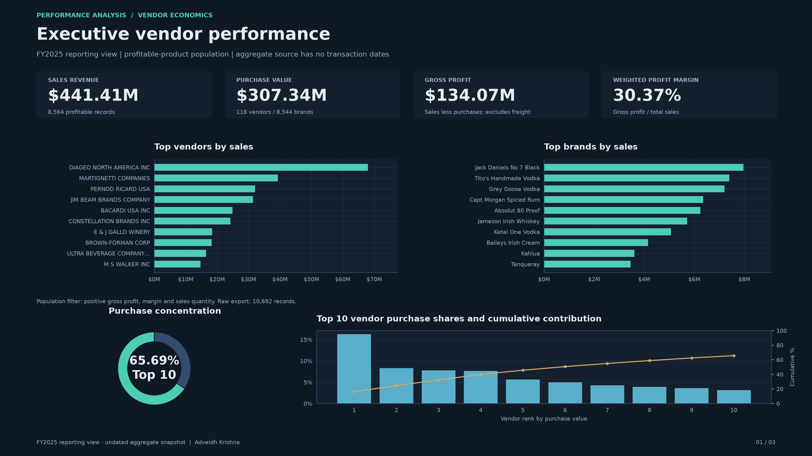
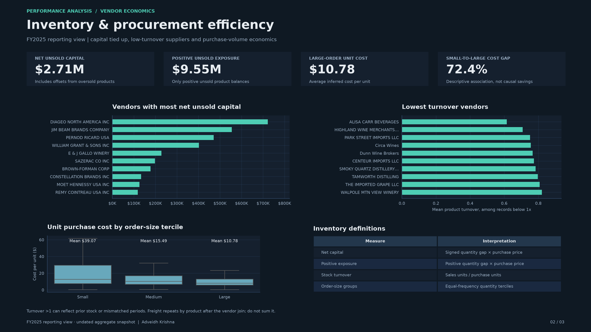
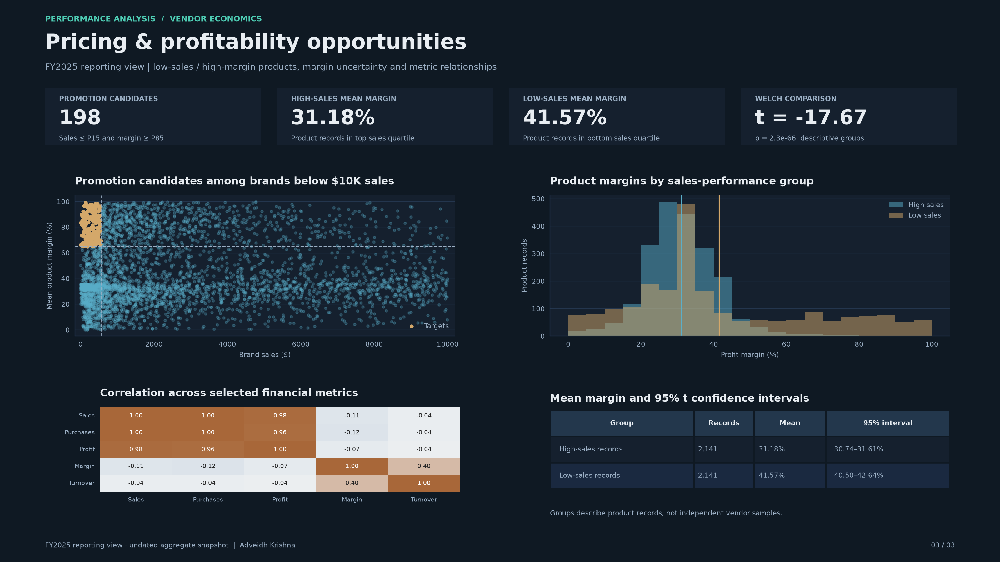

# Performance-Analysis-

Vendor performance, inventory efficiency and pricing analysis using Python, pandas, matplotlib, seaborn and SQLite. The repository includes an aggregate vendor/product export, a reproducible notebook, three executive dashboards and an optional Power BI report.

[Project repository](https://github.com/AKJ7320/Performance-Analysis-)

## Reporting scope and data

The dashboards use **2025 as the reporting view**. The included export contains no transaction-date or month column, so it cannot establish observed full-year coverage or support a monthly sales trend. No monthly figures are fabricated.

`dashboard/vendor_sales_summary_export.csv` contains **10,692 aggregate records**. Following the notebook, the principal analysis retains **8,564 records** with positive gross profit, profit margin and sales quantity. This population represents 118 vendors and 8,544 brand codes.

Valid numerical digit sequences in amounts, quantities and brand IDs use equivalent scientific notation where needed. Their exact decimal values are preserved. The dashboard recalculates all summaries from that export; no financial values are changed to resemble calendar years.

## Business findings

- Profitable-product sales: **$441.41M**; purchases: **$307.34M**; gross profit: **$134.07M**.
- Weighted gross margin: **30.37%**, calculated as total gross profit divided by sales.
- Top ten vendors account for **65.69%** of purchases in the selected population.
- **198** low-sales/high-margin brands meet the promotion-screening thresholds.
- Net unsold capital is **$2.71M**; positive unsold exposure is **$9.55M** before offsets from oversold records.

# Dashboard Screenshots

### Executive vendor performance

Sales, purchases, gross profit and weighted margin; vendor and brand sales rankings, purchase concentration and cumulative contribution.



### Inventory and procurement efficiency

Net and positive unsold exposure, low-turnover suppliers, volume-based unit costs and inventory definitions.



### Pricing and profitability analysis

Promotion candidates, high/low-sales margin distributions, confidence intervals, a Welch comparison and correlations.



All three executive dashboards are 3200 × 1800 pixels, 16:9 and 200 DPI. See [the metric catalog](docs/dashboard_catalog.md) for formulas, chart mapping and limitations, and [the analysis report](ANALYSIS_REPORT.md) for refreshed results.

## Run locally

Python 3.10 or newer is required. A dedicated local Python environment is prepared separately from the repository files.

```bash
python -m pip install -r requirements.txt
python dashboard/generate_dashboards.py
python -m unittest discover -s tests -v
```

`--output-dir` changes the PNG output directory. Every run also refreshes `dashboard/metrics.json`.

The notebook `Vendor Performace Analysis.ipynb` now reads the included CSV directly. Its saved outputs are cleared so running it produces current results. All executive dashboards and supporting exploratory charts are kept together under `screenshots/`.

For an optional rebuild from raw transaction files, place the external CSV inputs in `data/`, then run `ingestion_db.py` and `get_vendor_summary.py`. Those large inputs and `inventory.db` are not bundled. The dashboards and notebook work without them. `dashboard/Dashboard.pbix` is retained as an optional existing report; Python is the reproducible dashboard implementation.

## Repository structure

```text
Performance-Analysis-/
├── dashboard/
│   ├── generate_dashboards.py
│   ├── metrics.json
│   ├── vendor_sales_summary_export.csv
│   ├── Dashboard.pbix
│   └── background image.jpg
├── screenshots/
│   ├── executive_vendor_performance.png
│   ├── inventory_procurement_efficiency.png
│   ├── pricing_profitability_analysis.png
│   ├── boxplots.png
│   ├── category_counts.png
│   ├── correlation.png
│   ├── histogram.png
│   ├── summary statistics.png
│   └── findings/                  # Supporting vendor and pricing charts
├── docs/dashboard_catalog.md
├── tests/test_dashboard_metrics.py
├── Vendor Performace Analysis.ipynb
├── ingestion_db.py
├── get_vendor_summary.py
├── ANALYSIS_REPORT.md
├── requirements.txt
└── LICENSE
```

## Interpretation

Weighted margin replaces summing percentage values. Gross profit here is sales less product purchases; freight and other operating expenses are excluded. Freight repeats across product rows after a vendor-level join, so summing that column would overcount it. Turnover and unsold balances use aggregate quantities and can be affected by prior stock or different observation windows. The bulk-cost relationship is descriptive and does not establish causal savings. Margin comparisons group product records by sales quartile, rather than independent vendor-level samples.

# Author

Adveidh Krishna

Financial Analyst

[LinkedIn](https://www.linkedin.com/in/akthotarath)
